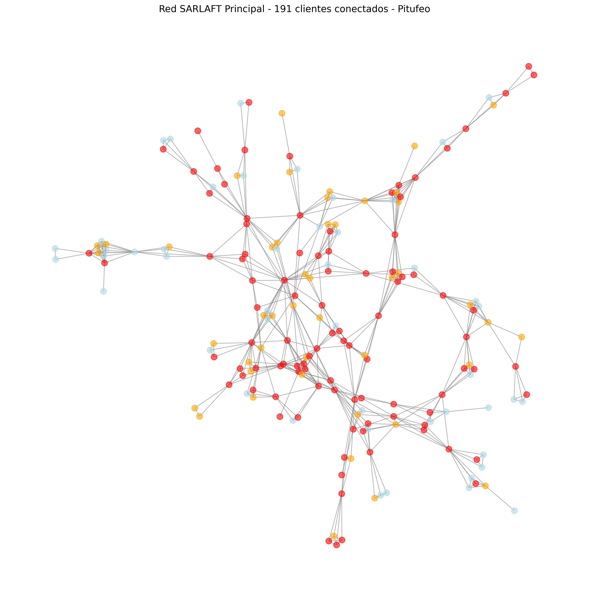

# SARLAFT Intelligence Hub

Plataforma analítica End-to-End para Unidad de Cumplimiento bajo normativa SFC Colombia.

Este proyecto simula la estrategia analítica para prevenir LA/FT con:
- Segmentación de factores de riesgo
- Scoring de riesgo individual
- Motor de alertas híbrido (reglas + ML)
- Análisis de grafos para pitufeo
- Screening de listas restrictivas
- Dashboard y reportería UIAF

# Stack
Python 3.10, Scikit-learn, XGBoost, NetworkX, Neo4j, Power BI

## Estado
Paso 0 - Setup Senior completado
## Detección de Redes
Red principal detectada de 191 clientes con 3522 relaciones - posible red de testaferros.
